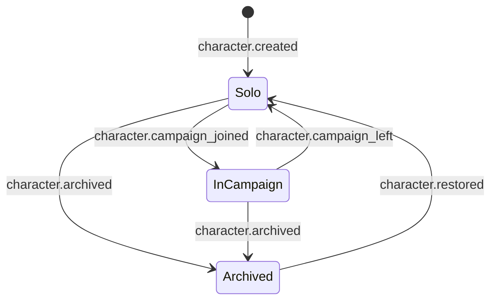

# Domain model and event catalog

All schemas live in `@hk/protocol` as Zod definitions; this document is the human
reference. Event `type` strings are stable public contract; payload changes bump `v`.

## Identifiers

| Thing | Format | Example |
|-------|--------|---------|
| User | `usr_` + 22-char base62 | `usr_3k9…` |
| Character | UUIDv7 | — |
| Campaign | UUIDv7 | — |
| Join code | 8 chars, Crockford base32, no vowels (avoids words) | `7QX4-M2HN` |
| Stream | `char:<characterId>` / `camp:<campaignId>` | — |
| Event | UUIDv7 (client-generated) | — |
| Entity | `<packId>:<type>/<slug>` | `srd-5e-2024:spell/fireball` |
| Choice | `<entityId>@<level>/<choiceSlug>` | `srd-5e-2024:class/fighter@1/fighting-style` |
| Blob | `sha256:<hex>` | — |
| Item instance | UUIDv7 | — |

## Entities (server-side, D1)

```
users(id, username, username_folded UNIQUE, salt, verifier_hash, created_at,
      quota_bytes_used, flags)
sessions(token_hash PK, user_id, device_label, created_at, last_seen_at, expires_at)
recovery_codes(user_id, code_hash, used_at)
characters(id PK, owner_id, name, system, campaign_id NULL, archived_at NULL,
           bytes_used, event_count, updated_at)
campaigns(id PK, dm_id, name, system, join_code UNIQUE, join_open, bytes_used, updated_at)
memberships(campaign_id, user_id, role: 'dm'|'player', display_name, joined_at,
            PRIMARY KEY(campaign_id, user_id))
```

D1 is an *index* (lists, lookups, quotas, auth). Truth for game data is the streams.

## Streams (Durable Object SQLite)

```
events(seq INTEGER PK, id TEXT UNIQUE, type, v, ts, actor_json, tx_id NULL,
       payload_json, bytes)
meta(key PK, value)            -- owner, campaign, pins, bytes_used, subscribers
packs(id, version, json)       -- CampaignStream only: enabled non-core packs
```

## Character facts (client-side, derived by the reducer)

```
Facts {
  id, system, name, grammaticalGender, appearance, portrait?: {hash, thumbHash},
  createdWith: {engineVersion, appVersion},
  pins: {packId → version},
  decisions: {choiceId → selection[]},          // selections are entity ids or literals
  classes: [{classId, level, subclassId?}],      // order = order gained
  xp, levelGrants (milestone),
  hp: {current, temp, max override?}, hitDice: {classId → spent}, deathSaves: {s, f},
  slots: {level → used}, pactSlots: {used},   // pact (Warlock) slots tracked apart from `slots` —
                                               // all pact slots share one level, so a running count
                                               // suffices; `derive` supplies the level/count from
                                               // `system.tables.spellSlots.pact` (phase 4 plan 11 task 3)
  resources: {resourceId → used},
  conditions: [{conditionId, source, since, until?, level?}],   // exhaustion has level
  concentration?: {spellId, since},
  inventory: [{instanceId, itemId, qty, equipped, attuned, name?, notes?, custom?}],
  currency: {cp, sp, ep, gp, pp},
  inspiration: boolean,
  options: {encumbrance?: off | standard | variant},   // per-character rule options, from
                                                       // character.options.set@1 (plan 14 task 5);
                                                       // {} for every older log
  notes: [{id, title, body, updated}],
  campaignId?, ownerId,
  skipped: [{eventId, reason}],
  lastSeq, appliedPendingIds
}
```

## Event catalog — character stream

Actor column: **O** owner, **D** DM of the character's campaign, **S** system (server-
generated, e.g. quota notices — none in v1).

| Type (v1) | Actor | Payload | Notes |
|-----------|-------|---------|-------|
| `character.created` | O | `{name, system, corePack: {id, version}, engineVersion, grammaticalGender}` | first event; pins the core pack |
| `character.renamed` | O, D(override) | `{name}` | |
| `character.appearance_set` | O | `{age?, height?, weight?, eyes?, hair?, skin?, description?}` | |
| `character.gender_set` | O | `{grammaticalGender}` | text only |
| `character.options.set` | O | `{encumbrance?: 'off' \| 'standard' \| 'variant'}` (strict object, every key optional) | per-character rule options (plan 14 task 5). The reducer needs `character.created` first, merges per key into `facts.options` (last write wins; an explicit `'off'` is stored, an empty patch keeps earlier keys). Derive uses `overrides.encumbrance ?? facts.options.encumbrance ?? 'off'`, so a campaign house rule always wins (doc 05, "Rule options"). `propose.setOptions(sheet, patch)` emits one event carrying only the changed keys, or none when nothing changes. New keys arrive as new optional fields. Additive: older logs fold to `options: {}` and derive byte-identically |
| `character.archived` / `character.restored` | O | `{}` | soft delete |
| `character.owner_transferred` | D, O | `{toUserId}` | claim / hand over |
| `character.campaign_joined` / `character.campaign_left` | O, D | `{campaignId}` | mirrored on campaign stream |
| `pack.pinned` | O, D | `{packId, version, previous?}` | rebase commits this; the wizard emits one per checked content pack, sorted by id, as the first drafts of the creation transaction that follows `character.created` (shared `txId` with the decisions, level, and HP drafts; plan 15 task 4) |
| `pack.unpinned` | O | `{packId}` (strict) | plan 15 task 1. The reducer deletes `pins[packId]` and never refuses: an id that is not pinned leaves facts unchanged, with no skip entry. Refusing to drop the core pin is the proposal's job (`propose.unpinPack` throws `pack.unpinCore`). Additive: older logs never contain it |
| `decision.made` | O | `{choiceId, selection: string[], context?}` | the builder's atom; for ability-score generation `context` holds `{method: standardArray \| pointBuy \| manual \| roll, scores, rolls?: [[d,d,d,d]…]}` so the timeline can show the dice |
| `decision.cleared` | O | `{choiceId}` | rare; used by rebase |
| `level.gained` | O | `{classId, level, hpRoll?: number \| "average", subclassId?}` | inside a `txId` with its decisions |
| `level.granted` | D | `{count?: 1}` | milestone mode |
| `xp.awarded` | D, O(solo) | `{amount, reason?}` | negative allowed for corrections |
| `hp.changed` | O, D | `{delta, kind: damage \| heal \| temp \| set, source?, damageType?}` | reducer clamps to [0, max]; temp HP rules applied |
| `hit_dice.spent` / `hit_dice.regained` | O | `{classId, count, healed?}` | |
| `death_save.recorded` | O, D | `{result: success \| failure \| critSuccess \| critFailure}` | reset by heal/stabilize |
| `stabilized` | O, D | `{}` | |
| `slot.spent` / `slot.restored` | O | `{level, pact?: boolean, count?}` | |
| `resource.spent` / `resource.restored` | O, D | `{resourceId, count?}` | second wind, rage…; `resourceId` is a slug OR `item:<uuid>` (Phase 4: per-instance item charges, keyed by the item's own `instanceId` — colon makes it collision-safe against any slug-keyed resource). `resource.restored` without `count` restores the resource fully; with `count` it restores that many, capped at full (`used = max(0, used − count)`). **Recorded-roll regain (plan 13 task 6):** a charged item with `regain` dice gets `resource.restored@1 {resourceId, count: <rolled total>}` from the rest proposal — the caller rolls, the event records only the total (no dice, no faces, no new field or version), so replay re-reads the recorded number and never re-rolls: the log alone reproduces `used`. Additive: older logs, with or without `count`, replay unchanged |
| `spell.prepared` / `spell.unprepared` | O | `{spellId, classId}` | |
| `spell.learned` / `spell.forgotten` | O | `{spellId, classId, source: levelUp \| scroll \| copy}` | spellbook / known |
| `spell.cast` | O | `{spellId, level, slotUsed?: boolean, concentration?: boolean}` | convenience event that folds to slot + concentration. **`level` semantics differ per lane:** a Pact Magic cast records the spell's BASE level (the pact slot's own level is implied by the caster's pact table, and pact casts are always cast at that slot level), while a regular-slot cast records the CAST-AT level (an upcast of a level-1 spell into a level-3 slot records `3`). A free cast (plan 13 task 4, `spell.grant.uses`) records `slotUsed: false` at the grant's level and travels with a `resource.spent` for its counter in the same transaction. **Flagged future protocol candidate (no schema change in v1):** the event carries no `classId`, so for a multiclass character whose classes share a spell list (e.g. Cleric + Paladin both preparing the same spell) a cast cannot be attributed to a specific class's spellcasting block; `propose.cast` likewise takes no class/spell-ownership parameter. Adding an optional `classId` is deferred until a rule actually needs per-class attribution. |
| `concentration.started` / `concentration.ended` | O, D | `{spellId?}` | |
| `condition.added` / `condition.removed` | O, D | `{conditionId, source?, until?, level?}` | exhaustion uses `level` |
| `item.added` | O, D | `{instanceId, itemId, qty, name?, custom?}` | `custom` = inline homebrew item definition (quick homebrew) |
| `item.removed` | O, D | `{instanceId, qty?}` | |
| `item.equipped` / `item.unequipped` | O | `{instanceId, slot?}` | |
| `item.attuned` / `item.unattuned` | O | `{instanceId}` | max 3 enforced by UI, not reducer |
| `item.updated` | O | `{instanceId, name?, notes?, qty?}` | |
| `currency.changed` | O, D | `{cp?, sp?, ep?, gp?, pp?}` | deltas |
| `rest.taken` | O | `{kind: short \| long, hitDiceSpent?: [...]}` | reducer applies the system's rest rules from the pinned core pack |
| `inspiration.changed` | O, D | `{value: boolean}` | |
| `note.added` / `note.updated` / `note.removed` | O | `{id, title?, body?}` | body ≤ 8 KB |
| `portrait.set` / `portrait.cleared` | O | `{hash, thumbHash, mime, w, h}` | blob announced implicitly |
| `override.applied` | D, O(solo) | `{path, value, reason}` | `path` is a Sheet path (`ac`, `abilities.str.score`, `speed.walk`); rendered distinctly |
| `event.reverted` | O, D | `{targetId?: eventId, txId?: uuid, reason?}` | reducer skips targets |
| `history.compacted` | O | `{throughSeq, facts}` | reserved; not emitted in v1 |

Rules the reducer applies (from the pinned core pack's `system` entity, not code):
temp HP does not stack (keep higher); damage hits temp first; healing from 0 clears death
saves; long rest restores HP, all slots, half hit dice (rounded down, min 1), resets
`longRest` resources, reduces exhaustion by 1; short rest resets `shortRest` resources. A long
rest also restores `dawn` charged items (v1 approximation; see doc 04, "Item charges and
attunement"). Resource resets are not reducer rules: they arrive as the rest proposal's
`resource.restored` events in the same transaction — the full-restore form, or (plan 13 task 6)
the `count` form carrying a caller-rolled regain total for an item with `regain` dice. A missing or
impossible total refuses the whole rest proposal, so no event is written (doc 04, "Rolled charge
regain").

### Rebase transaction (plan 15)

Pinning, unpinning, or updating a content pack writes ONE transaction, which shares a `txId`. Its
events come from the engine's `planRebase(...).events` (doc 04, "Rebase implementation"), always
in this order:

1. `pack.pinned {packId, version, previous?}`, one per changed or new pin, sorted by `packId`;
2. `pack.unpinned {packId}`, one per dropped pin (never the core);
3. `decision.made {choiceId, selection, context?}`, one per decision whose selection moved to a
   `deprecated.replacedBy` replacement, keeping the original `context`;
4. `decision.cleared {choiceId}`, one per decision the new pack set invalidates.

A plain pin (`propose.pinPack`) is a one-event transaction. Confirming the Build tab's report
appends the plan exactly. The homebrew fast-forward appends the same events per character with
`CharacterStore.appendTxToStream` (plan 15 task 7). No new event type carries the report:
replaying the log reproduces the result.

### `.hero` bundle manifest

`HeroBundleManifestSchema` (`packages/protocol/src/bundle/manifest.ts`) describes the
`manifest.json` of a `.hero` export. Plan 15 task 1 added the optional
`packs?: [{id, version, path, sha256}]`:
- `path` is `packs/<id>@<version>.json`, at most 256 characters; the reader requires exactly that
  form;
- `sha256` uses the `sha256:<64 hex>` blob-hash form;
- the pack's assets travel as `assets/<hex>`.

The writer omits the key for a core-only character, so older bundles and older readers see no
change (plan 15 task 6). Events and bundle manifests are not part of the generated pack JSON
Schema.

## Event catalog — campaign stream

Actor: **D** DM, **M** member (any role), **S** system.

| Type (v1) | Actor | Payload |
|-----------|-------|---------|
| `campaign.created` | D | `{name, system, corePack: {id, version}}` |
| `campaign.renamed` | D | `{name}` |
| `campaign.settings_changed` | D | `{settings}` (full document, see below) |
| `campaign.join_code_rotated` | D | `{joinCode}` (also updates D1) |
| `campaign.archived` | D | `{}` |
| `pack.enabled` / `pack.disabled` | D | `{packId, version, sha256}`. The campaign actor keeps only this list in its `packs` meta (for the non-core pack quota). No pack JSON is stored: the DO's `packs` table and `StreamStore.putPack` exist, but nothing writes them yet. The pack relay to members is a later slice (plan 15 owner-flag, doc 07 "Pack assets") |
| `member.joined` / `member.left` / `member.removed` | M / D | `{userId, displayName, role}` |
| `member.renamed` | M | `{displayName}` |
| `campaign.character_joined` / `campaign.character_left` | M, D | `{characterId, ownerId, name}` |
| `party.overview_updated` | M (owner's device) | `{characterId, overview: {hp, hpMax, temp, ac, level, classes, conditions, concentration, portraitThumb, passivePerception}}` — posted by the owner's device on change, throttled |
| `session.started` / `session.ended` | D | `{title?}` — groups the log and timeline |
| `roll.logged` | M | `{characterId?, label, formula, results: [{die, value}], total, kind: check \| attack \| damage \| save \| spell \| custom, visibility: everyone \| dm \| private, manual?: boolean}` |
| `chat.message` | M | `{text ≤ 2 KB, visibility}` (phase 3 optional) |
| `dm.note_added` / `dm.note_updated` / `dm.note_removed` | D | `{id, title?, body?}` — DM-only visibility |

### Campaign settings document

```
{
  system: "5e-2024",
  packs: [{id, version}],                          // enabled content
  houseRules: {
    strictValidation: true,                        // false = warnings only
    allowOverrides: true,
    editOutsideSession: "free" | "dmApproval" | "locked",
    xpMode: "xp" | "milestone",
    hpOnLevelUp: "roll" | "average" | "choice",
    encumbrance: "off" | "standard" | "variant",
    attunementMax: 3,
    startingLevel: 1
  },
  visibility: {
    partySheets: "none" | "overview" | "full",
    rolls: "everyone" | "dm",                      // players may still choose "private"
    allowPrivateRolls: true
  },
  join: { open: true, requireApproval: false }
}
```

## Ownership and lifecycle summary



Pregens: created by the DM inside the campaign (owner = DM); `character.owner_transferred`
on claim. A claimed pregen behaves like any player character.
